# Архитектура SafeSight

Один процесс FastAPI обслуживает одну камеру. Четыре worker-потока разделяют
захват, подготовку preview, инференс и обработку событий. Медленный TPU или
SQLite не входят в путь показа видео.

```mermaid
flowchart LR
    Camera[Камера или видео] --> Capture[Capture worker]
    Capture --> Latest[Последний Frame]
    Latest --> Preview[Preview worker: JPEG]
    Preview --> MJPEG[MJPEG для всех зрителей]
    MJPEG --> Browser[Браузер: чистое видео]
    Latest --> Infer[Inference worker: rate limit]
    Infer --> MQ[RabbitMQ]
    MQ --> Primary[YOLOv8n JPEG Gateway]
    MQ --> SV[SafetyVision JPEG Gateway]
    Primary --> TPU[Удалённый LinQ TPU worker]
    SV --> TPU
    TPU --> Primary
    TPU --> SV
    Primary --> Join[Join одного кадра]
    SV --> Join
    Join --> WS[WebSocket детекций]
    WS --> Overlay[Canvas поверх видео]
    Join --> Queue[Ограниченная очередь событий]
    Queue --> Rules[IoU tracks и RuleEngine]
    Rules --> Current[Текущие Warns]
    Rules --> Recorder[Evidence recorder]
    Recorder --> JPEG[Atomic JPEG и SHA256]
    Recorder --> Outbox[Durable outbox]
    Outbox --> DB[SQLite: события и проверки]
    DB --> Log[Backlog и CSV]
```

## Инварианты

1. Frame содержит `sequence`, монотонное время захвата, wall time, изображение и
   `generation`. Capture sequence не используется как биометрическая личность.
2. Latest-value буферы не растут при медленном читателе. Preview не ждёт RPC.
3. Pika принадлежит одному inference-потоку. По одному запросу in-flight в каждом
   JPEG-клиенте, явное ограничение FPS. При неоднозначном timeout тот же job не
   отправляется заново.
4. Только COCO primary определяет person/zone. SV person не дублирует людей.
   SV и primary объединяются по точному `(generation, sequence)`. Поздний ответ
   не переносится на новый JPEG. Join ограничен временем и числом кадров.
5. При отсутствии SV `safetyvision_observed=False`: это неизвестное состояние,
   а не отрицательное наблюдение СИЗ. Устаревшие/повторные кадры не подтверждают
   непрерывность. Переполнение очереди событий сбрасывает подтверждение.
6. No-helmet требует явного класса, ассоциации с верхней частью person и проверки
   противоположного hardhat. Отсутствие helmet-рамки не является нарушением.
   Fall имеет собственный track: COCO может пропустить горизонтального человека.
7. RuleEngine подавляет повторы эпизода. Warns и Backlog имеют разный жизненный цикл.
   Review оператора не меняет исходное наблюдение и не выключает правила.
8. Доказательный JPEG относится к кадру подтверждения. Intent и уникальный
   `event_key` позволяют повторить SQLite-запись после сбоя без дублирования.
9. Сетевой статус, mode и source каждого нового события явны. Локальный/Demo
   backend не становится LinQ при недоступности сети.

## Границы релиза

- Одна камера, один процесс; кластеризации и распределённого трекера нет.
- SQLite и файлы на локальном диске; нет репликации, внешнего retention и SLA.
- Preview ориентирован на 30 FPS, аппаратный inference — на фактический RTT.
- Авторизация опциональна, без RBAC/SSO; удалённое использование требует TLS.
- IoU tracker не устойчив к любому перекрытию, смене масштаба и длительному
  исчезновению объекта. Не выполняется идентификация людей.
- Не реализованы автоматические штрафы, медицинские выводы, распознавание лиц,
  автоматический вызов служб или внешние уведомления.
- Ограничения модели каски сохраняются и измерены отдельно от тестов интеграции.

См. [результаты](INTERNET20_RESULTS.md), [эксплуатацию](RUNBOOK.md),
[план пилота](BUSINESS_CASE.md).
